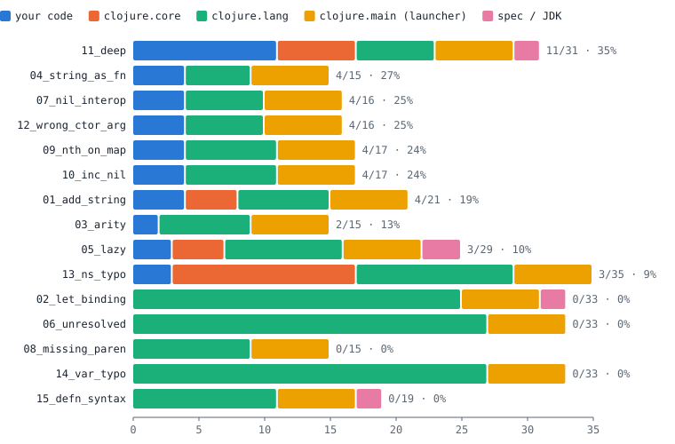
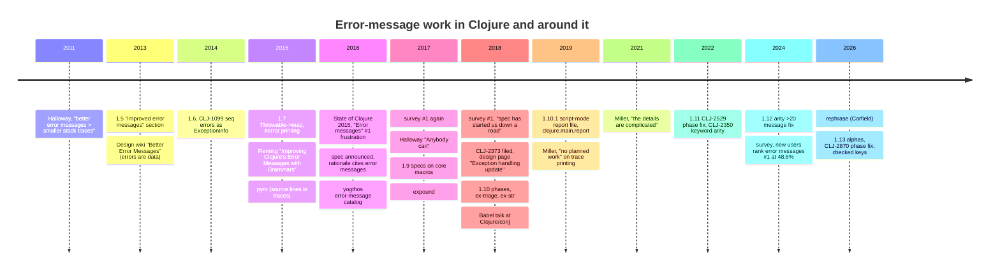
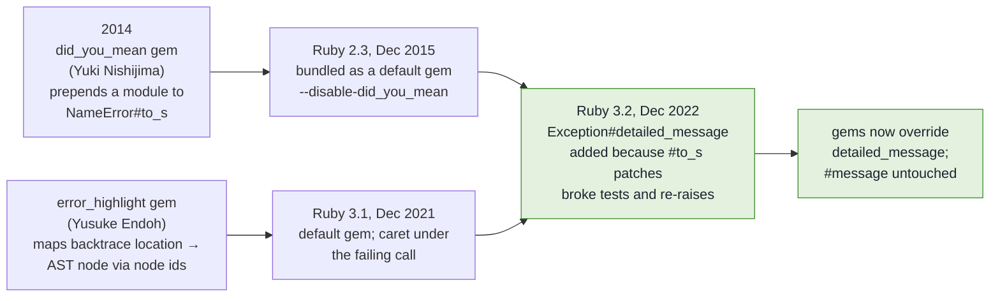
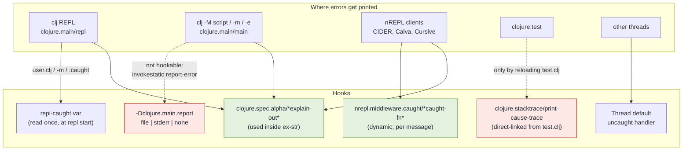
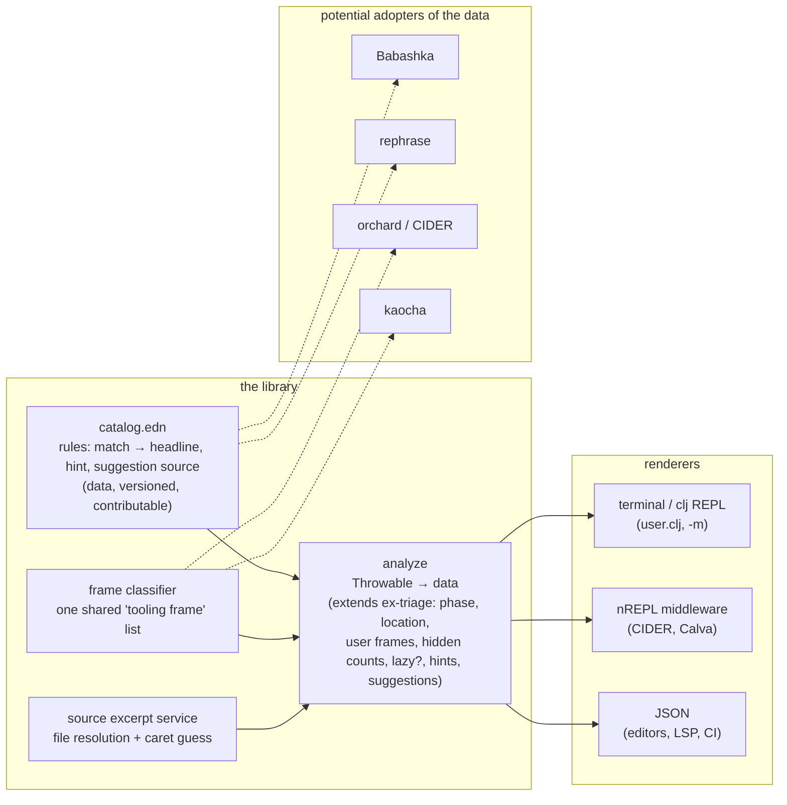

# Better error messages for Clojure: what it would actually take

*Research report, 2026-09-06. Everything here was either run in this repository (see [`experiments/`](experiments/)) or fetched and quoted from a primary source; the four source-by-source evidence files are in [`research/`](research/). Versions used: Clojure 1.8.0, 1.9.0, 1.10.3, 1.11.4, 1.12.6 and 1.13.0-alpha6 on OpenJDK 21; Babashka 1.12.214; clj-kondo 2025.07.28; expound 0.9.0; clj-commons/pretty 3.8.0; rephrase 1.0.4; Python 3.11.15; Ruby 3.3.6; Rust 1.94.1; Elm 0.19.1.*

---

## The short version

**Why are the messages like this?** They are not designed; they are what falls out of a dynamic language whose core functions run the happy path and let the JVM throw. Five mechanisms account for almost every complaint, and each is visible in the Clojure source (§2): the *text* of most runtime messages is written by HotSpot or the JDK in Java vocabulary; the JVM class file has no place to store a column, so a runtime error can never point at a sub-expression; compiled function names are munged and every call appears twice in a trace; lazy sequences move the failure away from the code that caused it; and macros inherit the call site's line while syntax-quote strips positions. On top of the mechanics sits a consistent, documented core-team stance (§2.8): errors should be data, the REPL rather than the stack trace is the debugging tool, "better messages, not stack-trace manipulation", and no planned work on trace printing.

**What has been tried?** Core did one real redesign, in Clojure 1.10 (Dec 2018: error phases, `ex-triage`/`ex-str`, the REPL prints a two-line summary and never a trace) and 1.10.1 (script mode writes the full report to a temp file). Since then only fixes; the 2024 survey still ranks error messages the #1 priority for new users at 48.6% (§3.1). The community has re-invented three things over and over (§3.2): message rewriting from regex tables (Babel 2018, Maria, Sean Corfield's `rephrase` 2026, a 2016 catalog), stack-frame filtering (pretty, CIDER/orchard, kaocha, Reveal, pyro, Babashka), and spec-error formatting (expound, the one hook core designed for). Source excerpts with a caret exist only where the tool owns the source: Babashka/SCI and shadow-cljs.

**What are the barriers?** Technical (§4): no columns at runtime; JVM-authored text; direct linking closes hooks (script mode cannot be hooked at all, and the REPL hook must be installed *before* `clojure.main/repl` starts, which `-e` cannot do); the core "user frame" heuristic is a hard-coded namespace list that points at `Integer.java:624` for two of the fifteen bugs in this corpus; and each REPL client prints errors its own way. Social: BDFL governance with a contributor agreement and a patch queue where a one-line message fix took four years; the philosophy above. Ecosystem: adoption follows tool bundling, not quality (expound: 20M downloads because figwheel and guardrails pull it in; Babel: 309).

**How do languages that do it well do it?** Elm and Rust spend their entire budget at *compile* time, where they have types, source spans and the source text; their runtime stories are "no runtime exceptions" (Elm) and a three-line panic with the backtrace off by default (Rust) (§5). Clojure's errors are overwhelmingly runtime errors, so the relevant models are the dynamic languages: Python 3.11 added a per-instruction column table to bytecode (PEP 657, at a measured 22% size cost) plus "Did you mean"; Ruby got the same features from *third-party gems* that were later bundled as defaults (`did_you_mean` 2014 → Ruby 2.3; `error_highlight` → Ruby 3.1) and then grew a real hook, `Exception#detailed_message` (3.2), because monkey-patching broke tests. JRuby filters JVM frames by default and keeps the raw trace one flag away.

**What can be done as an opt-in library?** Quite a lot (§6). The 370-line prototype in [`prototype/`](prototype/) shows what is reachable today with no change to Clojure: phase-aware headers, a source excerpt with a *guessed* caret, hidden internal frames with counts, plain-language headlines and hints from a rule catalog, "did you mean" for symbols, vars and namespaces, and expound for spec errors; its output for all fifteen bugs is in [`experiments/out/prototype/`](experiments/out/prototype/). What a library cannot do: know the real column of a runtime error, hook `clj -M script.clj`, or make CIDER, Calva, Cursive and `clj` agree. The recommended path is the Ruby path: ship the library with its rewrite/hint catalog as *data* other tools can consume, install through nREPL middleware, `user.clj` and a `-m` entry point, and use adoption numbers to back three small core asks (a dynamic error-printer var honored by both REPL and script mode; a public "tooling frame?" predicate; JDK frames treated as non-user in `ex-triage`). The column table is a fork experiment with a cost to measure, exactly as PEP 657 did.

---

## 1. What "bad" looks like today (experiment)

Fifteen small programs in [`experiments/bugs/`](experiments/bugs/), each a realistic mistake, were run under Clojure 1.12.6 in three ways: loaded at the `clj` REPL, run as a script with `clj -M`, and with the full Java stack trace printed (what a test runner, a log, or a pre-1.10 launcher shows). The runner is [`experiments/run.sh`](experiments/run.sh); every captured output is under [`experiments/out/`](experiments/out/).

### 1.1 The corpus and what Clojure 1.12.6 says

| # | The mistake | What `clj` prints (second line is the cause) | Who wrote the cause text |
|---|---|---|---|
| 01 | `(reduce + [10 20 "30"])` inside `total` | `Execution error (ClassCastException) at bugs.add-string/total (01_add_string.clj:4).`<br>`class java.lang.String cannot be cast to class java.lang.Number (java.lang.String and java.lang.Number are in module java.base of loader 'bootstrap')` | HotSpot (checkcast) |
| 02 | `(let [greeting "Hello" name] …)` | `Syntax error macroexpanding clojure.core/let at (bugs/02_let_binding.clj:4:3).`<br>`[greeting "Hello" name] - failed: even-number-of-forms? at: [:bindings] spec: :clojure.core.specs.alpha/bindings` | spec |
| 03 | `(area 5)` on a two-argument fn | `Execution error (ArityException) at bugs.arity/eval147 (03_arity.clj:6).`<br>`Wrong number of args (1) passed to: bugs.arity/area` | Clojure (ArityException.java) |
| 04 | `(s "!")` where `s` is a string | `Execution error (ClassCastException) at bugs.string-as-fn/shout (04_string_as_fn.clj:4).`<br>`class java.lang.String cannot be cast to class clojure.lang.IFn (java.lang.String is in module java.base of loader 'bootstrap'; clojure.lang.IFn is in unnamed module of loader 'app')` | HotSpot |
| 05 | lazy `map` of `Integer/parseInt`, realized later by `reduce` | `Execution error (NumberFormatException) at java.lang.NumberFormatException/forInputString (NumberFormatException.java:67).`<br>`For input string: "three"` | JDK |
| 06 | `pritnln` | `Syntax error compiling at (bugs/06_unresolved.clj:4:3).`<br>`Unable to resolve symbol: pritnln in this context` | Clojure compiler |
| 07 | `(.toUpperCase nil)` | `Execution error (NullPointerException) at bugs.nil-interop/shout (07_nil_interop.clj:4).`<br>`Cannot invoke "Object.getClass()" because "target" is null` | JDK (helpful NPE, JEP 358) |
| 08 | a missing `)` | `Syntax error reading source at (bugs/08_missing_paren.clj:5:1).`<br>`EOF while reading, starting at line 3` | Clojure reader |
| 09 | `(nth {:name "Ada"} 0)` | `Execution error (UnsupportedOperationException) at bugs.nth-on-map/first-field (09_nth_on_map.clj:6).`<br>`nth not supported on this type: PersistentArrayMap` | Clojure (RT.java) |
| 10 | `(inc (:prot c))`, a misspelled key | `Execution error (NullPointerException) at bugs.inc-nil/next-port (10_inc_nil.clj:6).`<br>`Cannot invoke "Object.getClass()" because "x" is null` | JDK |
| 11 | `Integer/parseInt` of `nil`, three functions deep | `Execution error (NumberFormatException) at java.lang.Integer/parseInt (Integer.java:624).`<br>`Cannot parse null string` | JDK |
| 12 | `(File. 42)` | `Execution error (IllegalArgumentException) at bugs.wrong-ctor-arg/file-of (12_wrong_ctor_arg.clj:4).`<br>`No matching ctor found for class java.io.File` | Clojure (Reflector.java) |
| 13 | `(:require [clojure.strng :as str])` | `Execution error (FileNotFoundException) at bugs.ns-typo/eval138$loading (13_ns_typo.clj:1).`<br>`Could not locate clojure/strng__init.class, clojure/strng.clj or clojure/strng.cljc on classpath.` | Clojure (RT.java) |
| 14 | `str/joinn` | `Syntax error compiling at (bugs/14_var_typo.clj:5:3).`<br>`No such var: str/joinn` | Clojure compiler |
| 15 | `(defn square (x) …)` | `Syntax error macroexpanding clojure.core/defn at (bugs/15_defn_syntax.clj:3:1).`<br>`x - failed: vector? at: [:fn-tail :arity-n :bodies :params] spec: …/param-list`<br>`(x) - failed: vector? at: [:fn-tail :arity-1 :params] spec: …/param-list` | spec |

What the table shows:

- **Six of fifteen cause messages are written by the JVM or JDK**, not by Clojure (01, 04, 05, 07, 10, 11). They talk about `java.lang.Number`, modules, class loaders, and in the two NullPointerException cases about `"x"` and `"target"`, which are parameter names inside `Numbers.java` and `Reflector.java`, not anything in the user's program.
- **None of the fifteen shows the offending source line**, and none offers a suggestion. Compile-phase errors (02, 06, 08, 14, 15) get `file:line:column`; runtime errors get `file:line` at best.
- **Two runtime errors point into the JDK** (05, 11): `Integer.java:624` is not somewhere the user can go. This is a limitation of the core printer's "first frame outside core" heuristic, explained in §2.7.
- **The spec-era messages (02, 15) are structurally better than the rest**: they say which form failed which predicate. They are also the only ones with an official extension point (§3.2, expound).

### 1.2 The three faces of a Clojure error

The same bug prints differently depending on where it happens, and the "noisy Java stack trace" complaint comes from the third face:

1. **At the `clj` REPL** (since 1.10): the two lines in the table. No stack trace is printed. Before 1.10 the REPL printed the exception's class, message and exactly one Java frame (source: `repl-caught` in the 1.9 `main.clj`); it has never printed a full trace by default.
2. **As a script** (`clj -M file.clj`, `-m`, `-e`; since 1.10.1): the same two lines, then `Full report at: /tmp/clojure-NNN.edn`, a file containing the triage map and the raw frames as data. Example: [`experiments/out/default/01_add_string.report.edn`](experiments/out/default/01_add_string.report.edn).
3. **Everywhere else**: `clojure.test` (`report :error` calls `clojure.stacktrace/print-cause-trace`, `test.clj:393-394`), logging frameworks, uncaught exceptions on non-main threads, nREPL clients' stack-trace views, and every Clojure before 1.10.1 print the raw JVM trace. For this corpus that is 15 to 35 frames per error, printed outermost wrapper first, so the actual cause appears after ~18 frames of launcher plumbing ([`experiments/out/default/11_deep.trace.txt`](experiments/out/default/11_deep.trace.txt)).

### 1.3 How much of a trace is yours

[`experiments/report_stats.clj`](experiments/report_stats.clj) classifies every frame in the fifteen script-mode reports by the class that owns it.



| bug | frames | first user frame at | user | clojure.core | clojure.lang | clojure.main | spec | jdk |
|---|---|---|---|---|---|---|---|---|
| 01_add_string | 21 | 7 | 4 | 4 | 7 | 6 | 0 | 0 |
| 02_let_binding | 33 | – | 0 | 0 | 25 | 6 | 2 | 0 |
| 03_arity | 15 | 3 | 2 | 0 | 7 | 6 | 0 | 0 |
| 04_string_as_fn | 15 | 1 | 4 | 0 | 5 | 6 | 0 | 0 |
| 05_lazy | 29 | 4 | 3 | 4 | 9 | 6 | 0 | 3 |
| 06_unresolved | 33 | – | 0 | 0 | 27 | 6 | 0 | 0 |
| 07_nil_interop | 16 | 2 | 4 | 0 | 6 | 6 | 0 | 0 |
| 08_missing_paren | 15 | – | 0 | 0 | 9 | 6 | 0 | 0 |
| 09_nth_on_map | 17 | 3 | 4 | 0 | 7 | 6 | 0 | 0 |
| 10_inc_nil | 17 | 3 | 4 | 0 | 7 | 6 | 0 | 0 |
| 11_deep | 31 | 3 | 11 | 6 | 6 | 6 | 0 | 2 |
| 12_wrong_ctor_arg | 16 | 2 | 4 | 0 | 6 | 6 | 0 | 0 |
| 13_ns_typo | 35 | 21 | 3 | 14 | 12 | 6 | 0 | 0 |
| 14_var_typo | 33 | – | 0 | 0 | 27 | 6 | 0 | 0 |
| 15_defn_syntax | 19 | – | 0 | 0 | 11 | 6 | 2 | 0 |
| **total** | **345** | | **43 (12.5%)** | 28 | 171 | 90 | 4 | 5 |

Every trace carries the same six `clojure.main` launcher frames; compile-phase errors carry 25 to 27 `clojure.lang.Compiler` frames and zero user frames. Half of the user frames are duplicates, because each Clojure function call shows up as an `invokeStatic` frame and an `invoke` frame (§2.4).

### 1.4 The same bug across Clojure versions

Bug 01 loaded at the REPL, from [`experiments/out/`](experiments/out/):

```
Clojure 1.8.0
user=> CompilerException java.lang.ClassCastException: class java.lang.String cannot be cast to class java.lang.Number (...), compiling:(/.../bugs/01_add_string.clj:6:1)

Clojure 1.10.3
user=> Syntax error (ClassCastException) compiling at (bugs/01_add_string.clj:6:1).
class java.lang.String cannot be cast to class java.lang.Number (...)

Clojure 1.11.4, 1.12.6, 1.13.0-alpha6
user=> Execution error (ClassCastException) at bugs.add-string/total (01_add_string.clj:4).
class java.lang.String cannot be cast to class java.lang.Number (...)
```

1.8 reports a runtime error as a `CompilerException` at the top-level form. 1.10.3 labels it a *syntax* error, still at the top-level form; that mis-triage of errors raised through `Compiler.load()` was fixed by CLJ-2529 in 1.11 (`changes.md` "4.4 Error messages"). From 1.11 on it names the function and the right line.

Bug 02 is the spec story. Clojure 1.8 said `let requires an even number of forms in binding vector in bugs.let-binding:4`. Clojure 1.9, which added specs to core macros, printed the entire explain-data map into the message, including a `#object[clojure.spec.alpha$regex_spec_impl$reify__2436 0x4917d36b ...]` and the `:args` forms (43 lines in script mode: [`experiments/out/clj19/02_let_binding.script.txt`](experiments/out/clj19/02_let_binding.script.txt)). Daniel Compton's analysis of the 2018 survey: "this year they have gotten worse with the introduction of specs on core macros" ([source](https://danielcompton.net/clojure-survey-2018)). 1.10 reduced it to the two lines in the table above.

---

## 2. Why the messages are like this: the anatomy

The diagram follows one piece of information, *where in the source the error is*, from the file to the printed message. Line numbers refer to the `clojure-1.12.3` tag (commit `e6393a40`); the full read is in [`research/04-internals.md`](research/04-internals.md).

```mermaid
flowchart LR
    SRC["Source text<br/><code>(reduce + prices)</code><br/>line 4, col 3"]
    RDR["LispReader<br/>:line/:column attached<br/><b>only to lists</b><br/>(LispReader.java:1254)"]
    CMP["Compiler<br/>LINE/COLUMN vars<br/>CompilerException carries<br/>:clojure.error/line + column<br/>(Compiler.java:7437)"]
    CLS["Class file<br/>LineNumberTable: <b>line only</b><br/>SourceFile: bare file name<br/>(Compiler.java:4314, 4910)"]
    JVM["HotSpot / JDK<br/>throws with <b>Java-authored text</b><br/>(Numbers.java:154 → checkcast)"]
    EX["Throwable<br/>StackTraceElement =<br/>(class, method, file, line)"]
    MAP["Throwable->map<br/>:via :trace :cause :phase"]
    TRI["ex-triage<br/>first frame outside a<br/><b>hard-coded ns list</b><br/>(main.clj:50-60, 257-265)"]
    STR["ex-str<br/>'Execution error (X) at f (file:line).'"]
    OUT["repl-caught / report-error<br/>nREPL *caught-fn*"]
    SRC --> RDR --> CMP
    CMP -- "compile-phase error:<br/>file:line:col kept" --> MAP
    CMP --> CLS --> JVM --> EX --> MAP --> TRI --> STR --> OUT
    classDef loss fill:#fde8e6,stroke:#b3261e,color:#1b2430;
    class RDR,CLS,JVM,TRI loss;
```



Red boxes are where information is lost or where text is authored outside Clojure.

### 2.1 Only lists know where they were read

`LispReader.java` attaches `:line`/`:column` metadata in exactly two readers: `ListReader` (lines 1254-1255) and `MetaReader` when the target is a seq (968-972). Vectors, maps and sets get nothing (1347-1371); symbols are interned bare (460-463); keywords, numbers and strings cannot carry metadata at all (`Keyword.java:24` is not an `IObj`). Syntax-quote explicitly removes positions from the forms it builds (1126-1131, comment `//filter line and column numbers`). So the finest location Clojure can ever attribute to a problem inside `(f x "y" :z)` is the opening paren of that list.

### 2.2 The class file has no column slot

The compiler carries the column all the way to code generation: `LINE`/`COLUMN` are dynamic vars (`Compiler.java:307-308`) rebound around every form (`analyzeSeq`, 7661-7669), and `CompilerException` stores both in its `:clojure.error/*` data (7437-7445). Then every emission site calls `gen.visitLineNumber(line, gen.mark())` (e.g. 4314 in `InvokeExpr.emit`). The bundled ASM API is `visitLineNumber(final int line, final Label start)` (`asm/MethodVisitor.java:759`); the class-file `LineNumberTable` attribute maps bytecode offsets to lines and nothing else. `visitSource` records the bare file name (`Compiler.java:4887-4910`), so a frame says `01_add_string.clj:4`, never a path and never a column.

That is why the compile-phase rows in §1.1 have `line:column` and the runtime rows only have `line`. Python solved the same problem for CPython bytecode by adding a second table, `co_positions`, at a measured 22% increase in `.pyc` size (PEP 657, §5.4). Nothing comparable exists on the JVM; Clojure would have to invent its own side table.

### 2.3 Happy path in core, Java text from the JVM

`clojure.core/+` inlines to `Numbers.add` (`core.clj:986-989`). `Numbers.add(Object, Object)` is `return ops(x).combine(ops(y)).add((Number)x, (Number)y);` (`Numbers.java:154-156`), and `ops()` has no type check: unknown classes fall through to `LONG_OPS` (1118). The `(Number)x` is a JVM `checkcast`, so the message `class java.lang.String cannot be cast to class java.lang.Number (java.lang.String and java.lang.Number are in module java.base of loader 'bootstrap')` is composed by HotSpot; `Numbers.java` never constructs a `ClassCastException`. The same is true of `(inc nil)`: the only two `NullPointerException`s constructed in `clojure.lang` are in `Namespace.java:248` and `Util.java:237`; every other NPE is the JVM's, and on JDK 14+ its "helpful" text names the Java parameter (`"x"` in `Numbers.ops(Object x)`). Eric Normand called this "accidental" error messages in 2018: "Clojure's core functions are, for the most part, implemented without checks on the arguments. They only code the 'happy path'" ([source](https://ericnormand.me/article/clojure-error-messages-accidental)).

Clojure's own Java runtime writes the rest in the same register: `Wrong number of args (%d) passed to: %s` (`ArityException.java:29`), `nth not supported on this type: PersistentArrayMap` (`RT.java:951`), `No matching ctor found for class java.io.File` (`Reflector.java:317`), `Don't know how to create ISeq from: java.lang.Long` (`RT.java:577`). The compiler's resolution errors are plain `RuntimeException`s (`Compiler.java:7918`, `7971`, `7976`), which is why they print with no class name.

### 2.4 Names are munged, and every call is two frames

A `defn` compiles to a class named `ns$name` (`FnExpr.parse`, `Compiler.java:4550-4568`); anonymous functions get `fn__<id>` from a global counter (`RT.nextID`, `RT.java:523-525`), so ids differ between runs; top-level forms are wrapped in `eval<id>` (7754-7758). The munging table maps `-` to `_`, `+` to `_PLUS_`, `?` to `_QMARK_` and so on (3365-3390), and `demunge` is lossy in the other direction (3396-3398). Direct-linkable functions get an `invokeStatic` method plus an `invoke` that delegates to it (6074, 6126-6128), so a single Clojure call contributes two adjacent frames, the second with the *definition* line rather than the call line. Result: `bugs.deep$parse_row$fn__147.invoke(11_deep.clj:4)`.

### 2.5 Lazy sequences move the failure

`(map f coll)` runs `f` inside `LazySeq.force` (`LazySeq.java:48-53`), called from `realize` (82-101) and `seq` (104-108), which `RT.seq` invokes wherever the sequence is first walked. Bug 05 builds the sequence on line 4 and fails on line 8, inside `reduce`; the trace shows `clojure.lang.LazySeq.sval/seq` frames between the consumer and the user's lambda. At the REPL, if the consumer is the printer, the phase becomes `:print-eval-result` and the message says `Error printing return value`.

### 2.6 Macros inherit the call site's line

`macroexpand1` calls the macro with the original form and does nothing to copy its metadata onto the expansion (`Compiler.java:7581-7582`); `analyzeSeq` analyses the expansion inside the `LINE`/`COLUMN` bindings of the call (7664-7675). Since syntax-quote strips positions (§2.1), every form a macro generates reports the line of the macro *call*, with no finer granularity. Only `fn` copies `(meta &form)` onto its output (`core.clj:45-47`, `4618-4622`), and Clojure's own test suite notes the limit: "`:line` meta on `&form` doesn't survive successive macroexpansions" (`test/clojure/test_clojure/errors.clj:63`).

### 2.7 What core does about it: the 1.10 printer

Since 1.10 the REPL prints `(-> e Throwable->map ex-triage ex-str)`. `Throwable->map` (`core_print.clj:473-507`) yields the cause chain and the *root cause's* frames as data. `ex-triage` (`main.clj:207-266`) picks the phase and, for execution errors, the location from "the first frame after `(drop-while core-class? trace)`", where `core-class?` (`main.clj:56-60`) means "class name starts with `clojure.lang.` or its namespace is in a hard-coded set" (`clojure.core`, `clojure.string`, `clojure.spec.alpha`, … at 50-54). `java.lang.Integer` is in neither, which is why bugs 05 and 11 are reported "at `java.lang.Integer/parseInt (Integer.java:624)`". `ex-str` (268-340) then formats one of nine templates, for example `"Execution error%s at %s(%s).%n%s%n"`. `repl-caught` (347-351) prints that and nothing else.

### 2.8 The stance behind the mechanics

The position has been stable for fifteen years, and it is a position, not neglect. Quotes, all verified in [`research/01-core-history.md`](research/01-core-history.md):

- Stuart Halloway, 2011, mailing-list thread titled "better error messages > smaller stack traces": "The core team is very interested in improving error messages, and relatively less interested in more code to manipulate stack traces … any old library code can reduce a stacktrace." ([source](https://groups.google.com/d/topic/clojure/WxV5Oego4R0))
- Halloway's 2013 design page "Better Error Messages": "Error information is data, and type-based error handling should be discouraged." "ExceptionInfo should not serialize data into the error message string."
- Rich Hickey's spec rationale (2016): "Many users, especially beginners, are frustrated and challenged by the error messages produced by hand-written parsing and destructuring code, especially in macros … macros are an instance of the problems above." ([source](https://clojure.org/about/spec))
- Halloway, "REPL-Driven Development" (2017): "does Clojure need to incorporate a bunch of changes in its 1.9 release cycle in order to provide a better experience for beginners? No. Who can make a better experience for beginners? Anybody!"
- Halloway's principles in CLJ-2373 (2018), the ticket behind 1.10: "exception messages should be small strings … never print arbitrary data into a message"; "flow data all the way to the edge"; "edge printing should be concise by default, configurable by user".
- Alex Miller, ask.clojure.org, 2019: "There are a number of libraries available to alter the printing of stacktraces … We do not currently have any planned work on this in the next Clojure release." ([source](https://ask.clojure.org/index.php/8343/display-clojure-stacktraces-planned-attacked-clojure-version))
- Alex Miller, 2021: "I do really want to see the actual stack trace so I don't think that should go away … a lot of people have poured time into this and the results are not (imo) better than the original … it seems easy but the details are complicated." ([source](https://ask.clojure.org/index.php/10470/stacktraces-clojure-functions-contain-irrelevant-information))

Read together: the core team will improve *message text* where Clojure authors it, will expose *data* for tools, and considers trace presentation and beginner-friendly rewriting to be the tools' job. That is precisely the space an opt-in library lives in.

---

## 3. What has been tried

### 3.1 Core, by version



| Version | Date | What changed for errors | Source |
|---|---|---|---|
| 1.5 – 1.8 | 2013–2016 | An "Error messages" section in every changelog; `Throwable->map` and `#error {…}` printing in 1.7 | `changes.md` |
| 1.9 | 2017-12 | Specs checked on core macros at compile time. Messages embedded the whole explain-data map (§1.4) | `changes.md` §2.1 |
| **1.10** | 2018-12 | Error *phases* (`:read-source`, `:macro-syntax-check`, `:macroexpansion`, `:compile-syntax-check`, `:compilation`, `:execution`, `:read-eval-result`, `:print-eval-result`); `:clojure.error/*` ex-data on `CompilerException`; public `ex-triage` and `ex-str` "that can be used by external tools"; `ex-info` frames elided; `pst` warns when a trace is the compiler's | [release post](https://clojure.org/news/2018/12/17/clojure110), [Miller's write-up](https://insideclojure.org/2018/12/17/errors/), CLJ-2373/2415/2420/2430/2435/2438 |
| 1.10.1 | 2019-06 | `clojure.main` as launcher catches errors, prints the triage message and writes the full report to a temp file; `--report` / `-Dclojure.main.report=file|stderr|none`; `report-error` public | `changes.md` §1.2, CLJ-2463 |
| 1.10.2/3 | 2020–21 | CLJ-2564 better `case` message shipped, then reverted (ticket Reopened) | `changes.md` |
| 1.11 | 2022-03 | CLJ-2529 runtime errors through `Compiler.load()` no longer reported as syntax errors (§1.4); CLJ-2350 keyword arity message (filed 2018) | `changes.md` §4.4 |
| 1.12 | 2024-09 | CLJ-2739 arity message for >20 args; CLJ-2640 `ex-info` nil map | `changes.md` |
| 1.13 alphas | 2026-07 | CLJ-2870 phase mis-categorized in the script-mode report; Fogus's checked keys / `req!` motivated by "misspelled keys … lead to failures that do not connect to the actual source of the problem (e.g. NPEs)" | release posts, JIRA |

JIRA carries 140 tickets labelled `errormsgs`/`error-reporting`: 21 closed in 1.10, 2 in 1.11, 2 in 1.12; 62 unresolved; the oldest open one is CLJ-5 from 2009. Alex Miller's own summary of 1.10: "One of the things I spent the most time working on for Clojure 1.10 (along with Rich and Stu) is updated error messages … This is still only scratching the surface."

The survey evidence: "Error messages" was added as a choice in the State of Clojure 2015 survey and was the top frustration in 2015, 2016 and 2018 ("The top result is clearly error messages though"). The 2019–2023 posts do not report that question; the 2023 free-text answers mention errors or stack traces in about 8% of 971 responses; the 2024 post's chart for new users puts error messages first at 48.62% (n=181). Details and caveats in [`research/01-core-history.md`](research/01-core-history.md) §A.

### 3.2 The ecosystem

Every project below was checked against its README or source on 2026-09-06; downloads are cumulative Clojars counts. Full notes: [`research/02-ecosystem.md`](research/02-ecosystem.md).

| Project | Since | What it does | Hook it uses | Adoption |
|---|---|---|---|---|
| **clj-stacktrace** (mmcgrana) | 2009 | Demunged, aligned traces | explicit `pst`; Leiningen `:repl-options {:caught …}` | 23.4M downloads, dead since 2015 |
| **pretty** (clj-commons, ex io.aviso) | 2013 | Coloured, chronological, filtered traces; rule-based frame hiding | replaces `clojure.main/repl-caught`, `clojure.repl/pst`, `clojure.stacktrace/*`, `print-method Throwable`, uncaught handler; nREPL middleware; reloads `clojure/test.clj` "due to direct linking" | 25.2M + 3.7M, active |
| **pyro** (venantius) | 2015 | Source lines next to frames | swaps the stacktrace printer | dead 2018 |
| **error-message catalog** (yogthos) | 2016 | Markdown catalog of errors, "inspired by the way Elm does this" | none | 441 stars, dormant |
| **expound** (Ben Brinckerhoff) | 2017 | Human-oriented spec explanations | `clojure.spec.alpha/*explain-out*`, honoured by `clojure.main/ex-str` | 20.1M, active (bundled by figwheel-main, guardrails) |
| **Babel** (Machkasova et al., UMN Morris) | 2018 | Beginner rewrites via a 559-line regex dictionary plus specs on core fns | nREPL `*caught-fn*` middleware | 309 downloads; Clojure/conj 2018 talk; papers 2016, 2019, 2025 |
| **CIDER / orchard** | 2013 / 2018 | `*cider-error*` buffer; frames flagged `clj/java/tooling/dup/repl/project` and toggled; spec problems re-rendered | nREPL op reading `*e` after the fact | 9.8M / 3.1M |
| **Cursive**, **Calva** | | Folded / clickable traces in the REPL window | closed source / cider-nrepl | commercial / n.a. |
| **Babashka / SCI** (borkdude) | 2019 | `----- Error / Context / Stack trace -----` with a source excerpt and caret | owns the interpreter, so every form's line *and column* survive to runtime | 4.6k stars |
| **shadow-cljs** (thheller) | 2015 | Boxed compile errors with excerpt and caret | owns the compiler | 6.9M |
| **kaocha**, **Reveal**, **Portal**, **FlowStorm** | | Frame elision in test output; formatted Throwables; exception viewer; time-travel to the throw | own printers / instrumentation | 8.2M / 54K / 3.0M / 122K |
| **clj-kondo** | 2019 | Static linting incl. a "rudimentary" `:type-mismatch` | none at runtime | 8.2M |
| **rephrase** (Sean Corfield) | 2026 | One-line rephrasing from a regex config ("Expected a number, but was given a string"); credits Babel | `:caught` replacement + nREPL middleware | 30 stars, active |
| guardrails, malli, phrase | | Structured validation → human text at the boundary | their own macros/fns | 1.0M / 12.6M / 369K |

What five of them print for bug 01 (`(reduce + [10 20 "30"])`), captured in [`experiments/out/`](experiments/out/):

```
── Clojure 1.12.6 ─────────────────────────────────────────────────────────────
Execution error (ClassCastException) at bugs.add-string/total (01_add_string.clj:4).
class java.lang.String cannot be cast to class java.lang.Number (java.lang.String and java.lang.Number are in module java.base of loader 'bootstrap')

── rephrase 1.0.4 ─────────────────────────────────────────────────────────────
Expected a number, but was given a string, at bugs.add-string/total (01_add_string.clj:4) - runtime error (unexpected type).

── clj-commons/pretty 3.8.0, (pst) ────────────────────────────────────────────
         clojure.core/eval      core.clj:3236
                       ...
       bugs.add-string/total   01_add_string.clj:   4
       clojure.core/reduce      core.clj:6968
         clojure.core/+         core.clj:994
        java.lang.ClassCastException: class java.lang.String cannot be cast to class java.lang.Number ...

── Babashka 1.12.214 ──────────────────────────────────────────────────────────
----- Error --------------------------------------------------------------------
Type:     java.lang.ClassCastException
Message:  java.lang.String cannot be cast to java.lang.Number
Location: /.../bugs/01_add_string.clj:4:3

----- Context ------------------------------------------------------------------
1: (ns bugs.add-string)
2:
3: (defn total [prices]
4:   (reduce + prices))
     ^--- java.lang.String cannot be cast to java.lang.Number
5:
6: (total [10 20 "30"])

----- Stack trace --------------------------------------------------------------
clojure.core/+        - <built-in>
clojure.core/reduce   - <built-in>
bugs.add-string/total - /.../bugs/01_add_string.clj:4:3
bugs.add-string       - /.../bugs/01_add_string.clj:6:1

── clj-kondo 2025.07.28 (static) ──────────────────────────────────────────────
(nothing: the type error is not visible statically; kondo catches 02, 03, 06, 08, 14, 15 of the corpus)
```

Babashka is the one existing Clojure that shows the *column* for a runtime error. It can, because SCI is an interpreter: the form and its metadata are still in hand when the error happens. That is the whole difference from the JVM path in §2.2.

### 3.3 Patterns

1. **Four hook points cover everything.** The REPL's `:caught` slot / `clojure.main/repl-caught` (pretty, clj-stacktrace, rephrase); nREPL's `nrepl.middleware.caught/*caught-fn*`, a dynamic var whose default *is* `clojure.main/repl-caught` (Babel, rephrase, pretty's `wrap-pretty`) or an op that inspects `*e` afterwards (CIDER); `clojure.spec.alpha/*explain-out*` (expound); or owning the runtime (Babashka, shadow-cljs).
2. **Message rewriting has been rebuilt as a regex table at least four times** (Babel, Maria, rephrase, the 2016 catalog), each by one person or one classroom. rephrase reusing Babel's mappings in 2026 is the first time one table fed another.
3. **Frame filters have been rebuilt at least six times** (pretty's `default-frame-rules`, orchard's `tooling-frame-re`, kaocha's `*stacktrace-filters*`, Reveal, pyro, Babashka's `sci.impl.` cut). No shared definition of "tooling frame" exists, in core or out.
4. **Source excerpts appear only where the tool already has the source.** Neither core nor CIDER shows one.
5. **Adoption follows bundling.** expound rides inside figwheel-main and guardrails; clj-stacktrace rode inside Leiningen-era tooling; standalone beginner-message projects stay in the hundreds of downloads. The one core signal about any of them is Alex Miller in 2017: "I have been too busy to look at expound, but hope to soon".

---

## 4. Barriers

### Technical

- **T1. No column for runtime errors.** The JVM's `LineNumberTable` has no column slot (§2.2). A library can only guess (the prototype guesses from the innermost `clojure.core` frame's function name and says so). Only the compiler could emit a side table.
- **T2. The text is not Clojure's.** Six of fifteen messages are HotSpot's or the JDK's (§2.3); their wording changes between JDK versions (Babel's dictionary already carries three phrasings of `ClassCastException`), so any rewrite table is a maintenance liability.
- **T3. Direct linking closes the hooks.** `clojure.main/main` calls `report-error` with `invokestatic` (verified with `javap` on `clojure-1.12.6.jar`: `invokestatic clojure/main$report_error.invokeStatic`), so no `alter-var-root` can change what `clj -M script.clj` prints; the only lever is `-Dclojure.main.report`. `clojure.test` calls `clojure.stacktrace/print-cause-trace` the same way; pretty has to reload `clojure/test.clj` to intercept it. And the REPL's `:caught` default is captured when `clojure.main/repl` starts, while `-e`/`-i` initialisers run *inside* it (`main.clj:525-527`), so `clj -e "(install!)" -r` silently does nothing; a `user.clj` on the classpath or a custom `-m` works (§6.2).
- **T4. The "user frame" heuristic is a list.** `core-class?` knows `clojure.lang.` and a fixed set of namespaces (`main.clj:50-60`). JDK frames count as user code, hence `Integer.java:624`; any library not on the list will have its frames blamed.
- **T5. Laziness and macros relocate blame** (§2.5, §2.6). A source excerpt can be shown for the failure site, but the *cause* site is not recoverable from the exception.
- **T6. One printer per client.** `clj`, nREPL/CIDER, Calva, Cursive, Babashka, kaocha and clojure.test each render errors independently; there is no single place to plug in.
- **T7. Names are unstable.** `fn__147` and `eval1318` change every run; demunging is lossy (§2.4), so frames cannot be used as keys for anything.

### Social and governance

- **S1. The stated philosophy** (§2.8): messages yes, trace manipulation no, and "Anybody can" do the beginner experience outside core.
- **S2. The process.** Rich Hickey is BDFL; a signed Contributor Agreement is required; issues start on ask.clojure.org and move to JIRA only when the core team files them; patches must be small and are reviewed "primarily in the late alpha / early beta period" ([clojure.org/dev](https://clojure.org/dev/dev)). CLJ-2350, a one-message fix with a community patch, went from filed (2018-05) to shipped (2022-03). Code generated by an LLM is explicitly not acceptable under the CA ([contributor agreement page](https://clojure.org/dev/contributor_agreement)).
- **S3. Compatibility.** Tests in the wild match on message strings; Halloway's CLJ-2373 notes that "programs that parse exception messages … probably should not do this", but changing wording still breaks them, which argues for additive hooks rather than new text.
- **S4. Disagreement about what "better" is.** Miller: prettified traces "are not (imo) better than the original". The research literature agrees the details matter: Marceau, Fisler and Krishnamurthi found novices "often misinterpret the source highlighting" and recommend that "error messages should not propose solutions" because wrong hints mislead ([Onward! 2011](https://cs.brown.edu/~sk/Publications/Papers/Published/mfk-mind-lang-novice-inter-error-msg/)); Rust's guide bans "did you mean" phrasing in favour of statements; Python, Ruby, Elixir and Gleam all shipped "Did you mean" anyway.

### Ecosystem

- **E1. Fragmentation** of effort into regex tables and frame filters nobody shares (§3.3).
- **E2. Adoption follows bundling**, so a library that is not pulled in by a REPL client or a build tool will not be seen (§3.3).
- **E3. The best existing precedent, Babashka, cannot be transplanted**: its excerpt depends on being an interpreter.

---

## 5. How languages that do it well do it

Bug 01, the same mistake, in seven environments. All captured in [`experiments/other-langs/`](experiments/other-langs/) and [`experiments/out/`](experiments/out/).

```
── Clojure 1.12.6 ──────────────────────────────────────────────────────────────
Execution error (ClassCastException) at bugs.add-string/total (01_add_string.clj:4).
class java.lang.String cannot be cast to class java.lang.Number (java.lang.String and java.lang.Number are in module java.base of loader 'bootstrap')

── Python 3.11 (runtime) ───────────────────────────────────────────────────────
Traceback (most recent call last):
  File ".../add_string.py", line 4, in <module>
    total([10, 20, "30"])
  File ".../add_string.py", line 2, in total
    return sum(prices)
           ^^^^^^^^^^^
TypeError: unsupported operand type(s) for +: 'int' and 'str'

── Ruby 3.3 (runtime) ──────────────────────────────────────────────────────────
ruby/add_string.rb:2:in `+': String can't be coerced into Integer (TypeError)
	from ruby/add_string.rb:2:in `sum'
	from ruby/add_string.rb:2:in `total'
	from ruby/add_string.rb:5:in `<main>'

── Rust 1.94 (compile time) ────────────────────────────────────────────────────
error[E0277]: cannot add `&str` to `{integer}`
 --> add_string.rs:6:15
  |
6 |     let t = 1 + "2";
  |               ^ no implementation for `{integer} + &str`
  |
  = help: the trait `Add<&str>` is not implemented for `{integer}`
  ...
For more information about this error, try `rustc --explain E0277`.

── Rust 1.94 (runtime panic, RUST_BACKTRACE unset) ─────────────────────────────
thread 'main' (13179) panicked at panic.rs:4:21:
index out of bounds: the len is 3 but the index is 5
note: run with `RUST_BACKTRACE=1` environment variable to display a backtrace

── Elm 0.19.1 (compile time) ───────────────────────────────────────────────────
-- TYPE MISMATCH --------------------------------------------- src/AddString.elm

I cannot do addition with String values like this one:

10|     1 + "2"
            ^^^
The (+) operator only works with Int and Float values.

Hint: Switch to the (++) operator to append strings!

── Prototype (this repo, Clojure 1.12.6, opt-in library) ───────────────────────
-- RUNTIME ERROR ------------------------------------------ ./bugs/01_add_string.clj:4

Arithmetic on a String instead of a number.

2 |
3 | (defn total [prices]
4 |   (reduce + prices))
  |           ^
5 |
    (the JVM records only a line number; the column is a guess)

ClassCastException: class java.lang.String cannot be cast to class java.lang.Number (...)

Hint: One of the values reaching the arithmetic on this line is a String. If it came from user input or a file, convert it first (`parse-long`, `parse-double`).

In your code (innermost first):
    bugs.add-string/total                      01_add_string.clj:4
    bugs.add-string/eval1318                   01_add_string.clj:6
    ... 20 internal frames hidden (clojure.core 3, clojure.lang 10, clojure.main 7). (nice-errors.core/pst) shows them.
```

And the typo (`pritnln`), where "did you mean" is the whole point:

```
── Clojure 1.12.6 ─────────────────────────   ── Python 3.11 ────────────────────────────
Syntax error compiling at (bugs/06_...:4:3).   NameError: name 'pritn' is not defined.
Unable to resolve symbol: pritnln in this      Did you mean: 'print'?
context
── Ruby 3.3 ───────────────────────────────   ── Elm 0.19.1 ─────────────────────────────
undefined method `pritn' for main             -- NAMING ERROR ------- src/Typo.elm
(NoMethodError)                                I cannot find a `List.lenght` variable:
                                               6|  ... (List.lenght xs)
  pritn "count:", xs.length                                ^^^^^^^^^^^
  ^^^^^                                        The `List` module does not expose a
Did you mean?  print                           `lenght` variable. These names seem close
               printf                          though:
                                                   List.length ...
```

Full notes with quotes and file references: [`research/03-other-languages.md`](research/03-other-languages.md).

### 5.1 Elm: the budget is spent where the information is

Evan Czaplicki's two 2015 posts set the principles most people mean by "nice": show the code exactly as written, with line numbers; put the general context above the excerpt and the specific hint below; give every message a hint; ship a JSON form (`--report=json`) from day one; and "Compilers should be assistants, not adversaries" ([Compiler Errors for Humans](https://elm-lang.org/news/compiler-errors-for-humans), [Compilers as Assistants](https://elm-lang.org/news/compilers-as-assistants)). Architecturally a report is a four-field record, `Report { _title, _region, _sgstns, _message }` (`compiler/src/Reporting/Report.hs`), rendered against the retained source (`Render/Code.hs`). Every AST node is `At Region a`. And the reason there is nothing to say about Elm's *runtime* messages: "One big goal of Elm is to have no runtime errors. In practice, this is pretty much already how it goes."

### 5.2 Rust: structured diagnostics for tools, terse panics for users

A `rustc` diagnostic is data first: level, message, code, spans with labels, children (`note`/`help`), suggestions with an `Applicability` confidence so `rustfix` can apply them, all emitted as JSON with `--error-format json` ([rustc-dev-guide](https://rustc-dev-guide.rust-lang.org/diagnostics.html)). RFC 1644 (2016) introduced the underline-and-label format with the explicit goal "Draw inspiration from Elm". The style guide is opinionated in ways worth copying: "The error or warning portion should not suggest how to fix the problem, only the 'help' sub-diagnostic should"; "Suggestions should not be a question … language like 'did you mean' should be avoided"; "The word 'illegal' is illegal." The runtime side is the opposite: a panic is three lines, and the backtrace is opt-in with `RUST_BACKTRACE=1` (the capture above; this environment had it set to 1 by default, which is why the first run showed a trace). Rust extracted its renderer into crates (`annotate-snippets`, `codespan-reporting`, `ariadne`, `miette`) that other compilers, Gleam among them, use.

### 5.3 Python: a dynamic language that fixed runtime tracebacks

Python is the closest analogue to Clojure's situation, and it did the two things a library cannot do for Clojure. **PEP 657** (3.11) added "a mapping from each bytecode instruction to the start and end column offsets" so tracebacks can underline the failing sub-expression; the cost was measured ("increase the size of the standard library's pyc files by 22%") and an opt-out provided (`-X no_debug_ranges`). The 3.10 PEG parser enabled specific syntax messages ("'{' was never closed", "Perhaps you forgot a comma?") and "Did you mean" for names and attributes, extended in 3.12 to imports and in 3.13 to keyword arguments, with colour by default. The documented limitation is instructive: "Did you mean" lives in `PyErr_Display()`, so "This won't work if `PyErr_Display()` is not called, which can happen in some REPLs like IPython", the same one-printer-per-client problem as T6.

### 5.4 Ruby: the opt-in-then-default path, with a hook at the end



`did_you_mean` was a third-party gem from February 2014 and became a default gem in Ruby 2.3 ("The did_you_mean gem shows the candidates on the NameError and NoMethodError to ease debugging"). `error_highlight` became a default gem in Ruby 3.1; it works because the VM can map a backtrace location back to the AST node it was compiled from (`RubyVM::AbstractSyntaxTree.of(location, keep_script_lines: true)`). Both patched `Exception#to_s`, which "may break some tests" and made re-raised exceptions "add their suggestion multiple times", so Ruby 3.2 added `Exception#detailed_message`, which "the default error printer calls … instead of #message" ([Feature #18564](https://bugs.ruby-lang.org/issues/18564)). Gem → default gem → core hook, each step justified by the previous one's adoption and breakage. This is the trajectory the Clojure question is really asking about.

### 5.5 JRuby and Groovy: the JVM constraint is solvable at the printer

JRuby "reconstruct[s] that trace using a combination of JVM stack trace frames and our per-thread, artificially-maintained interpreter frames" and shows a 7-line Ruby trace where the raw JVM trace is ~60 lines; the raw version is `-Xbacktrace.style=raw` away ([JRuby wiki](https://github.com/jruby/jruby/wiki/BacktraceGeneration)). Groovy ships `StackTraceUtils.sanitize`, driven by a package-prefix list in a system property, and logs the unfiltered trace so nothing is lost. Both chose *filter by default, raw on request*, the inverse of Clojure's `pst`, which filters only `RestFn` and `AFn` frames (`repl.clj:261-262`).

### 5.6 What the research says

Becker et al.'s 2019 survey of 300+ papers distils ten guidelines: plain language and concision; relevant information near the offending code; context; positive tone; examples; solutions or hints; user control over presentation; scaffolding from language concepts to the error; a coherent narrative; the right amount of information at the right time ([DOI 10.1145/3344429.3372508](https://doi.org/10.1145/3344429.3372508)). Barik et al. (ICSE 2017) showed with eye tracking that developers do read messages, that reading difficulty predicts task performance, and that 13–25% of fixations land on error text. Marceau, Fisler and Krishnamurthi (2011) are the caution: novices misread highlights as "edit here" and vocabulary matters more than highlighting. The Clojure-specific work is Machkasova's group at UMN Morris: a 2016 study (11 participants, Racket vs Clojure vs rewritten Clojure) concluded "The stack trace in standard Clojure is uninformative and overwhelming, makes it hard to find errors", and Babel came out of it.

### 5.7 Feature comparison

| Feature | Elm (CT) | Rust CT / RT | Python (RT) | Ruby (RT) | Babashka | Clojure 1.12 | Prototype |
|---|---|---|---|---|---|---|---|
| Source excerpt with caret at the failing sub-expression | yes | yes / no | yes (PEP 657) | yes (error_highlight) | yes | no | line yes, column guessed |
| Location in the user's code, not the runtime's | yes | yes / backtrace off by default | yes | yes | yes | file:line, except JDK-thrown | yes |
| Plain-language *why* | yes | yes | partly | partly | no | no | catalog, 13 rules |
| Concrete hint | every message | `help`, never a question | "Did you mean" | did_you_mean | no | no | yes |
| Error codes + long explanation | links | `E0277`, `--explain` | no | no | no | no | no |
| Structured/JSON form for tools | `--report=json` | `--error-format json` | `co_positions` API | `detailed_message` | ex-data | `Throwable->map`, `ex-triage`, report file | data map |
| Internal frames hidden by default, raw on request | n/a | `RUST_BACKTRACE` | no | no | 5+5, `--debug` | REPL: none shown; elsewhere: all | hidden with counts, `pst` |
| Third-party hook to decorate errors | no | crates for other languages | `PyErr_Display` | `detailed_message` | no | `*explain-out*`, `repl-caught` (with T3 caveats) | |

The lesson is not "be like Elm". Elm and Rust are static; every "nice" message in those captures is a *compile-time* message, and their runtime errors are terse by design. Fourteen of the fifteen Clojure bugs are runtime or reader/macro errors that no type system catches (clj-kondo, the nearest thing to a static pass, flags six). The models are Python and Ruby, and their fixes were (a) per-instruction position tables in the VM and (b) printer-level rewriting shipped as opt-in packages first.

---

## 6. Options for doing it as an opt-in library

### 6.1 Where a library can attach, and the catch on each



| Hook | Kind | Verified behaviour |
|---|---|---|
| `clojure.main/repl` `:caught` | option | Full control, but only for REPLs *you* start |
| `clojure.main/repl-caught` | plain fn, `alter-var-root` | Works if changed before `repl` runs. `-e`/`-i` run inside `repl` (`main.clj:525-527`), so installing from them has no effect (verified: both pretty and the prototype are silently ignored). A `user.clj` on the classpath is loaded by `RT.doInit` (`RT.java:506`) before the REPL and works; so does `clj -M -m your.main`. |
| `clojure.main/report-error` | plain fn | Cannot be intercepted: `main` calls it via `invokestatic` (verified with `javap`). Script-mode output is fixed to `ex-str` + report file; only the target is configurable. |
| `nrepl.middleware.caught/*caught-fn*` | dynamic var, default `clojure.main/repl-caught` | Read per message; can be set from inside a session or by middleware (`nrepl/middleware/caught.clj`). This is where Babel, rephrase and pretty's middleware plug in, and it covers CIDER and Calva. |
| `clojure.spec.alpha/*explain-out*` | dynamic var | Honoured by `ex-str` in every client (verified with expound in REPL and script mode). |
| `clojure.stacktrace/print-cause-trace` | plain fn | `clojure.test` is direct-linked to it; pretty reloads `clojure/test.clj` after redefining. |
| `Thread/setDefaultUncaughtExceptionHandler` | JVM | Non-main threads only; `clojure.main` catches main-thread errors first. |
| `print-method Throwable` | multimethod | Controls `#error {…}` when an exception is *printed as a value*; not used by `repl-caught`. |
| `-Dclojure.main.report`, `--report` | property/flag | Selects the script-mode target; format is fixed. |

### 6.2 What is reachable today: the prototype

[`prototype/src/nice_errors/core.clj`](prototype/src/nice_errors/core.clj) uses only the hooks above and only information already in the exception. Output for every bug is in [`experiments/out/prototype/`](experiments/out/prototype/); the runner is [`experiments/run-proto.sh`](experiments/run-proto.sh). Three more of its outputs:

```
-- COMPILE ERROR ---------------------------------- ./bugs/06_unresolved.clj:4:3

`pritnln` is not defined here.

2 |
3 | (defn report [xs]
4 |   (pritnln "count:" (count xs)))
  |   ^

RuntimeException: Unable to resolve symbol: pritnln in this context

Hint: It may be misspelled, defined later in the file, or live in a namespace that has not been required.

Did you mean one of these?
    println
```

```
-- RUNTIME ERROR --------------------------------------- ./bugs/13_ns_typo.clj:1

The namespace clojure.strng is not on the classpath.

1 | (ns bugs.ns-typo
  | ^
2 |   (:require [clojure.strng :as str]))

FileNotFoundException: Could not locate clojure/strng__init.class, clojure/strng.clj or clojure/strng.cljc on classpath.

Hint: Either the name is misspelled, or the library that provides it is missing from deps.edn / project.clj.

Did you mean one of these?
    clojure.string
```

```
-- RUNTIME ERROR ------------------------------------------ ./bugs/05_lazy.clj:4

Could not parse "three" as a number.

2 |
3 | (defn parse-all [xs]
4 |   (map #(Integer/parseInt %) xs))
  |   ^

NumberFormatException: For input string: "three"

Hint: Validate or trim the string first, or use `parse-long`/`parse-double`, which return nil instead of throwing.

Note: this happened while a lazy sequence was being realized, which can be far from the `map`/`filter`/... that built it.

In your code (innermost first):
    bugs.lazy/parse-all/<anon>                 05_lazy.clj:4
    bugs.lazy/eval1329                         05_lazy.clj:8
    ... 29 internal frames hidden (clojure.core 7, clojure.lang 12, clojure.main 7, jdk 3). (nice-errors.core/pst) shows them.
```

What it does, and how, because each technique is reusable:

| Feature | Technique | Limit |
|---|---|---|
| Phase-aware header, location | `clojure.main/ex-triage` output, plus a fallback to the first non-internal frame when triage points at a `.java` file (fixes 05 and 11) | Depends on triage's data |
| Source excerpt | Resolve `:clojure.error/path`, else the var's `:file` metadata, else search classpath dirs for the bare file name | REPL input has no file (`NO_SOURCE_FILE`) |
| Caret column for runtime errors | Guess: find the innermost `clojure.core` function's name in call position on that line, or a `(.method` / arithmetic operator; say it is a guess | Wrong when the same function appears twice on a line; no column at all in many cases |
| Frame filtering with counts | Prefix list; collapse `invokeStatic`/`invoke` pairs; demunge; `pst` for the raw trace | A prefix list, like everyone else's |
| Headline + hint | 13 rules matching exception class, message and frame classes (arithmetic on string/nil, calling a non-fn, arity with the real `:arglists`, `nth` on a map, reflection, number parsing, missing namespace, unresolved symbol, no such var, unbalanced delimiters, macro spec) | Regexes over JDK text; each JDK may re-word |
| Did you mean | Levenshtein over `clojure.core` publics plus the file's own namespace map, over the aliased namespace's publics, over `all-ns` plus a classpath scan for `.clj` files | Candidate sets are heuristics |
| Spec errors | Sets `*explain-out*` to expound's printer when present | |
| Install | `alter-var-root` `repl-caught` and nREPL's `*caught-fn*`; default uncaught handler; via `user.clj` or `-m nice-errors.main` | Not script mode (T3) |

It is 390 lines, has no dependencies beyond Clojure, and was written in an afternoon. The point is not that it is good; it is that the *ceiling* for a library is roughly here, and the ceiling is well above what ships.

### 6.3 A design that could earn buy-in

The observed failure mode of previous attempts is one author, one regex table, one client. The thing worth building is the piece everyone keeps re-implementing, packaged so that the tools already in use can adopt it without adopting a UI:



- **Analysis as data, rendering separate.** Mirror Elm's `Report` and Rust's `Diagnostic`: the library's core function returns a map; three renderers consume it. Reveal and orchard already consume `ex-triage` data; they could consume a superset.
- **The catalog is the product.** An EDN file of `{:match {...} :headline ... :hint ... :suggest ...}` rules, with tests that pin each rule to a captured exception (like Elm's `error-message-catalog`, which "is a collection of Elm programs that trigger error messages"). Babel's dictionary, rephrase's config and the 2016 catalog are three seeds for it. Rules should target *Clojure-authored* messages first (arity, `nth`, reflector, reader, resolution) because those strings are stable, and JDK-authored text second, keyed by JDK version.
- **One "tooling frame" definition.** Publish the prefix list and let pretty, orchard, kaocha and Reveal depend on it; today each has its own.
- **Follow the research where it is clear.** Excerpt with the exact source; context above, hint below; hints as statements, not questions (Rust); never a hint the rule cannot justify (Marceau); a raw-trace escape hatch on every message (Becker's "user control").
- **Ship the JSON renderer early.** Editors and CI are where "buy-in" is decided; Elm and Rust both shipped JSON before anything else adopted them.

### 6.4 Opt-in mechanics that work today

- `deps.edn` alias: `{:aliases {:nice {:extra-deps {…} :extra-paths ["dev"]}}}` with `dev/user.clj` calling `install!`; or a `:main-opts ["-m" "nice-errors.main"]` alias. Both verified in [`experiments/deps.edn`](experiments/deps.edn).
- nREPL: middleware in `~/.clojure/deps.edn` or the project's `.nrepl.edn`; Calva and CIDER jack-in pass middleware through. rephrase ships exactly this.
- Leiningen: `:injections` and `:repl-options {:caught …}`.
- Script mode: not possible; document `-Dclojure.main.report=stderr` as the workaround, and offer `clj -M -m nice-errors.main script.clj` as a launcher that loads the file inside a REPL-style catch.
- Tests: a kaocha plugin or a `clojure.test` `report :error` override (a multimethod, so no direct-linking problem there).

### 6.5 What only core can do, and the smallest asks

Ruby's lesson is that the hook came *after* the gems proved the demand. In the same spirit, the asks below are small, additive, and each is motivated by a measured gap in this report:

1. **A dynamic error-printer var read at each error**, honoured by both `clojure.main/repl` and `clojure.main/main`'s script path (removing the `-e` and `invokestatic` walls of T3). This is the `Exception#detailed_message` moment: one var, no behaviour change unless bound.
2. **Make `core-class?` public and extensible**, and treat `java.*`/`jdk.*`/`sun.*` frames as non-user in `ex-triage` (T4; fixes the `Integer.java:624` location in bugs 05 and 11 for everyone, in every client).
3. **A `:clojure.error/hint`-style slot** in triage data that a bound analysis function may fill, so `ex-str` can print a third line without core owning any catalog.
4. **Longer term, a column side table.** The compiler already has the column at every `visitLineNumber` call (§2.2). A custom class-file attribute (or a static table keyed by bytecode offset) mapping offsets to columns, read reflectively by the printer, is the JVM analogue of PEP 657. It should be prototyped in a fork with the size and time cost measured, as PEP 657 did (22%), before anyone proposes it.

Each of these fits the process constraints in S2: a compelling problem statement with data, a small patch, no new wording that tests could depend on.

### 6.6 Risks

- **Wrong hints are worse than none** (Marceau et al.). Every catalog rule needs a captured exception it is tested against, and hints should be phrased as facts about the failure, not guesses about the fix.
- **JDK text drift.** Rules over HotSpot/JDK messages will break; version-key them and fall back to the raw message.
- **Column guessing** must always be labelled as a guess, as the prototype does, or it will teach people to distrust the tool.
- **Two printers disagreeing** (CIDER's buffer and the library's REPL output) is confusing; the nREPL middleware and the JSON renderer exist to avoid that.
- **Performance**: classpath scans for "did you mean" on namespaces and file lookups must be lazy and cached; they are cheap once but not per error.

### 6.7 A staged roadmap

1. **Library + catalog + nREPL middleware + JSON**, seeded from Babel/rephrase/prototype rules, tested against a captured-exception corpus like the one in `experiments/bugs/`. Publish adoption numbers.
2. **Get the data adopted by one tool that already has users**: Babashka (its `Context` block could use the catalog's headlines), Calva or CIDER (the middleware), kaocha (the frame list).
3. **Take asks 1 to 3 to ask.clojure.org** with the adoption data and the Ruby precedent, as separate small tickets.
4. **Prototype the column table in a fork**, measure, and publish the numbers before proposing anything.

---

## 7. Reproducing this

```bash
# Clojure CLI, Babashka and clj-kondo were installed in a scratch directory; see the paths in experiments/run.sh
cd research/clojure-error-messages/experiments
./run.sh                 # Clojure 1.12.6: REPL, script, and full-trace output for every bug → out/default/
./run.sh clj19           # same under Clojure 1.9.0 (aliases: clj18 clj19 clj110 clj111 clj113)
bb report_stats.clj out/default    # frame composition table
python3 make_chart.py    # ../figures/frame-composition.svg
./run-proto.sh           # the prototype on every bug → out/prototype/
bb bugs/01_add_string.clj          # Babashka's output
clj-kondo --lint bugs              # static analysis
# other languages: other-langs/{python,ruby,rust,elm}/ contain the sources and captured .out files
```

## Evidence files

- [`research/01-core-history.md`](research/01-core-history.md): surveys, changelogs, JIRA tickets, design pages, quotes from the core team, governance pages.
- [`research/02-ecosystem.md`](research/02-ecosystem.md): every library and tool above, with mechanism, status and download counts.
- [`research/03-other-languages.md`](research/03-other-languages.md): Elm, Rust, Python, Ruby, Racket research, Elixir, Gleam, JRuby, Groovy.
- [`research/04-internals.md`](research/04-internals.md): the Clojure source read, with `file:line` for every claim in §2.

Corrections to things commonly believed, all verified above: the `clj` REPL has never printed a full stack trace by default (1.9 printed one frame; 1.10 removed it); expound is by Ben Brinckerhoff, not Bruce Hauman (figwheel bundles it); the `ClassCastException` wording is HotSpot's, not Clojure's; and Clojure 1.10.x labelled runtime errors in loaded files as "Syntax error" until 1.11.
